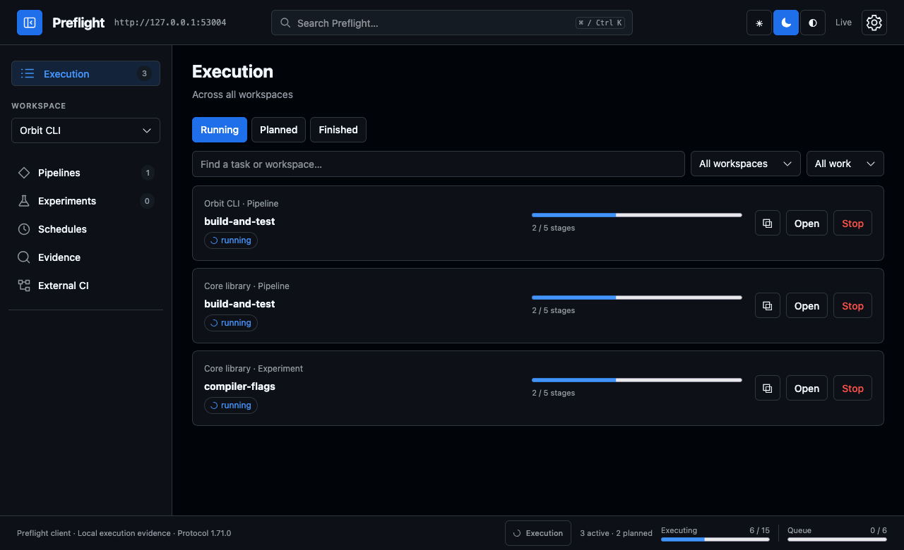
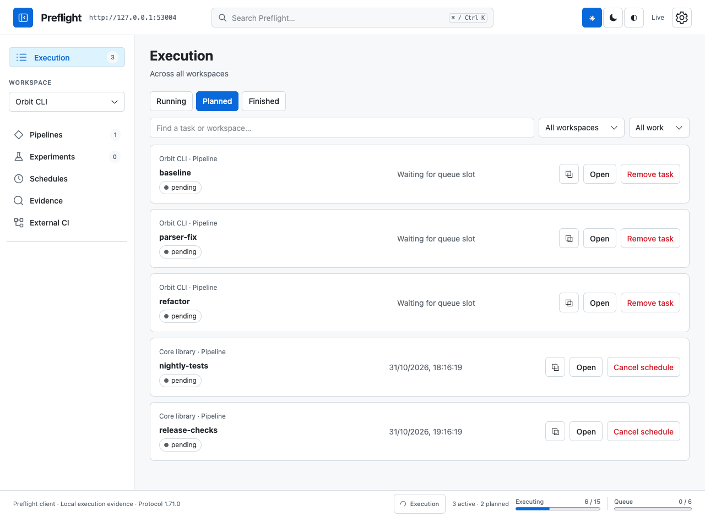
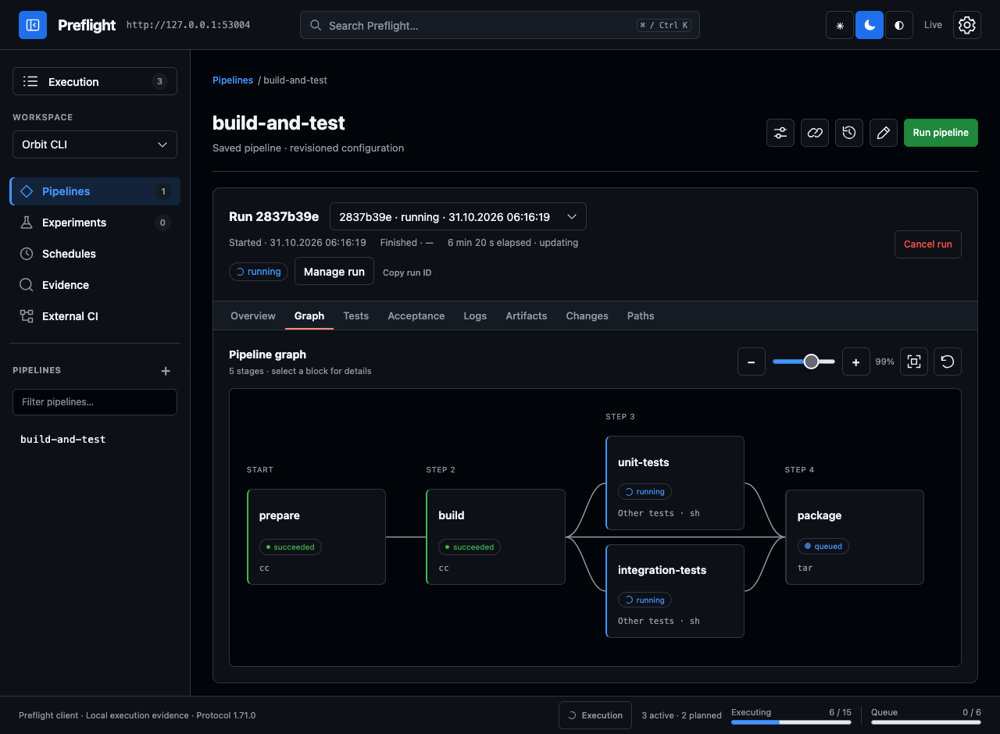

# Preflight

Run builds and tests on your machines before pushing a change. Queue candidate
commits or patches, set a concurrency limit, and compare their results.

Through MCP, a coding agent submits a job and gets a run ID immediately. It can
return for the result or fetch just a failing stage's logs. You can follow or
stop the same run in the Web UI.

A **pipeline** is the saved recipe. A **run** is one execution, with its own
source snapshot, logs, test reports and artifacts.

One Rust server provides the Web UI and MCP. Results live in SQLite and files
in your data directory. Installation and server operation need no Node.js or Python.

## Queues

For example: queue three candidate patches, allow two runs at a time, then compare
which tests failed. Independent changes can run in parallel. Cumulative queues
apply a patch series in order and block later items when a step fails.

Watch or stop pipelines and experiments across workspaces in one execution view.



<details>
<summary>Planned tasks and the pipeline graph</summary>

The Planned view includes code changes waiting for capacity and scheduled runs.



Inside a run: build first, tests in parallel, then package.



</details>

*Screenshots use isolated demo projects with deliberately held test stages.*

[Queue examples](docs/change-queues.md) · [MCP setup](docs/mcp-configuration.md) ·
[Retry a stage or test](docs/retries.md)

## Start from source

Requires Rust 1.89 or newer and a C compiler for SQLite.

```sh
git clone https://github.com/MaxLaneDev/preflight.git
cd preflight
cargo build --release --locked -p preflight
cp -n preflight.example.toml preflight.toml
./target/release/preflight --config preflight.toml serve
```

Web: **http://127.0.0.1:4170** · MCP: **http://127.0.0.1:4170/mcp**

[Server setup](docs/server-setup.md) covers allowed project directories, credentials,
resource limits and autostart. Public curl/Homebrew packages are not published yet.

## Define a pipeline

In your project, save `.preflight/pipeline.yaml` and add `/.preflight/` to `.gitignore`.
A pipeline runs ordinary commands; choose the tools your project needs.

```yaml
version: 1
pipeline:
  stages:
    - id: test
      kind: test
      command:
        program: go
        args: [test, ./...]
```

After allowing the project directory in the server configuration:

```sh
preflight --config /path/to/preflight.toml test /path/to/project
```

Use the built binary's full path if `preflight` is not on PATH.
Commands run with the server account's permissions. Run trusted projects only.

| Example | Configuration |
| --- | --- |
| Go | [go-basic](examples/go-basic/preflight.yaml) |
| C | [c-basic](examples/c-basic/preflight.yaml) |
| C++ / CMake | [cpp-basic](examples/cpp-basic/preflight.yaml) |

## More

- [Pipelines](docs/pipelines.md) · [Experiments](docs/experiments.md) · [Schedules](docs/schedules.md)
- [SSH workers](docs/worker-bootstrap.md) · [Environment setup](docs/environment-setup.md)
- [Logs and search](docs/evidence.md) · [Cleanup](docs/storage-gc.md) · [Archives](docs/run-archives.md)
- [All guides](docs/README.md)

Release checks target macOS ARM64 and Linux ARM64. Windows and physical x86_64
acceptance are deferred. Future work includes additional platforms and workers
that connect through NAT without inbound ports.

[MIT license](LICENSE). Packages include dependency notices.
